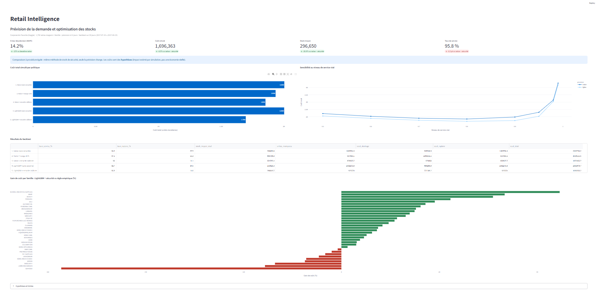
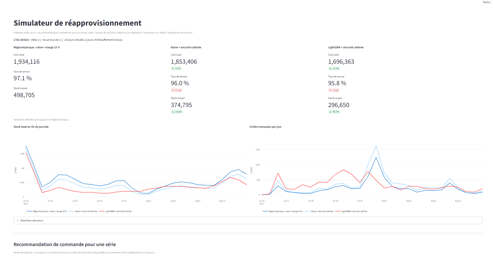
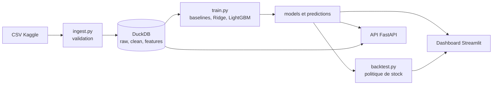

# Retail Intelligence : prévision de la demande et optimisation des stocks

Projet de bout en bout : des ventes brutes à une **quantité à commander**, avec un pipeline reproductible, un modèle de prévision à 14 jours, une simulation de politique de stock, une API et un dashboard interactif.

**Auteur :** abderrahmane azzou · **Résumé exécutif :** [EXECUTIVE_SUMMARY.md](EXECUTIVE_SUMMARY.md)





## Problème

Une chaîne de magasins doit décider chaque jour combien commander pour chaque produit. Commander trop peu provoque des ruptures, commander trop immobilise du capital. Le projet répond en trois étapes : **données → prévision → décision de stock**, avec un impact estimé par simulation.

## Résultats

Données : [Corporación Favorita, *Store Sales - Time Series Forecasting*](https://www.kaggle.com/competitions/store-sales-time-series-forecasting) (Kaggle), 54 magasins × 33 familles de produits, soit 1 782 séries et environ 3 millions de lignes (2013 à août 2017).

**Prévision à 14 jours, sur 28 jours de test (19 juillet au 15 août 2017) :**

| Modèle | MAE | RMSE | WAPE | Biais |
|---|---|---|---|---|
| Naïve (lag 14) | 87,5 | 322,6 | 18,6 % | +1,3 % |
| Naïve (moyenne de 3 lags) | 75,8 | 267,4 | 16,1 % | +1,6 % |
| Ridge | 98,5 | 329,1 | 21,0 % | -0,2 % |
| **LightGBM** | **66,7** | **243,9** | **14,2 %** | -1,1 % |

**Backtest de la politique de stock** (mêmes 28 jours, 1 782 séries, délai de 2 jours, revue quotidienne) :

| Politique | Service | Stock moyen | Coût total simulé |
|---|---|---|---|
| 1. Naïve, sans stock de sécurité | 93,3 % | 206 900 | 2 003 733 |
| 2. Naïve + marge fixe de 15 % | 97,1 % | 498 705 | 1 934 116 |
| 3. Naïve + sécurité calibrée | 96,0 % | 374 795 | 1 853 406 |
| 4. LightGBM, sans stock de sécurité | 92,7 % | 153 925 | 2 002 480 |
| **5. LightGBM + sécurité calibrée** | 95,8 % | 296 650 | **1 696 363** |

- **À procédure égale (5 vs 3)** : coût simulé **-8,5 %**, stock moyen **-20,9 %**, service quasi identique. C'est l'effet de la seule qualité de la prévision.
- **Contre la règle empirique (5 vs 2)** : coût -12,3 % et stock -40,5 %, mais service plus bas (95,8 % contre 97,1 %).
- LightGBM bat la baseline naïve aux 8 niveaux de service testés (réduction de coût de 2,8 % à 12,2 %).

> **Les coûts sont des hypothèses** (rupture = 1 par unité manquée, stockage = 0,1 par unité et par jour) : le jeu de données ne contient ni prix ni marge. L'impact est **estimé par simulation**, pas mesuré sur une entreprise réelle.

## Architecture



```
retail-intelligence/
├── sql/              # 01_clean, 02_features, 03_dashboard_aggs (executés par ingest.py)
├── src/
│   ├── ingest.py     # CSV -> DuckDB, validation, exécution du SQL
│   ├── train.py      # split chronologique, baselines, Ridge, LightGBM, métriques
│   ├── inventory.py  # stock de sécurité calibré, simulation, recommandation
│   └── backtest.py   # backtest des 5 politiques, sensibilité
├── api/main.py       # FastAPI : /health /metadata /forecast /recommend
├── app/dashboard.py  # Streamlit : synthèse, prévisions, simulateur
├── tests/            # 29 tests pytest
├── models/, reports/ # artefacts produits par train.py et backtest.py
├── Dockerfile, docker-compose.yml
└── requirements.txt, pytest.ini
```

## Choix techniques

- **SQL en trois couches sous DuckDB** (raw, clean, features) : du vrai SQL (fonctions de fenêtre, jointures) sans serveur à installer. PostgreSQL aurait coûté du temps de configuration sans rien changer au raisonnement.
- **Un modèle global** sur les 1 782 séries plutôt qu'un modèle par série : il partage l'information entre séries et exploite les covariables (promotions, calendrier, trafic).
- **Prévision directe à 14 jours, sans fuite de données :** toutes les variables dérivées des ventes, des transactions et du pétrole sont décalées d'au moins 14 jours (`LAG(..., 14)`, fenêtres `40 PRECEDING AND 14 PRECEDING`). Un test pytest le vérifie : modifier une valeur au jour t ne change aucune variable avant t + 14.
- **Cible `log1p(ventes)`** : les ventes sont très asymétriques, avec beaucoup de zéros.
- **Validation chronologique** : entraînement jusqu'au 20 juin 2017, validation du 21 juin au 18 juillet, test du 19 juillet au 15 août. Le test n'est utilisé qu'une fois.
- **Baselines exigeantes** : lag 14 et moyenne de trois lags, pour vérifier que le Machine Learning apporte quelque chose.
- **Stock de sécurité calibré sur la validation** : facteur par famille = quantile du ratio ventes réelles / prévues agrégé sur (délai + période de revue) jours. Le niveau de service (0,80) minimise le coût simulé **sur la validation**, jamais sur le test.
- **Écarté volontairement** : deep learning, MLflow, orchestrateur et déploiement cloud. Sur des données tabulaires, une comparaison rigoureuse vaut mieux qu'un modèle plus complexe, et l'architecture reste déployable sur un service de conteneurs.

## Installation et lancement

Prérequis : Python 3.11 ou plus récent.

```bash
python -m venv .venv
.venv\Scripts\activate            # Windows ; sous Linux/macOS : source .venv/bin/activate
pip install -r requirements.txt
```

**1. Données.** Téléchargez les fichiers de la [compétition Kaggle](https://www.kaggle.com/competitions/store-sales-time-series-forecasting) dans `data/raw/` : `train.csv`, `stores.csv`, `oil.csv`, `holidays_events.csv`, `transactions.csv`. Ils ne sont pas inclus dans ce dépôt (conditions d'utilisation de Kaggle).

**2. Pipeline.**

```bash
python src/ingest.py     # ingestion, validation, SQL (raw -> clean -> features)
python src/train.py      # entraînement et évaluation (--quick pour un test rapide)
python src/backtest.py   # backtest de la politique de stock
```

**3. Dashboard** (trois pages : synthèse, prévisions, simulateur de stock) :

```bash
streamlit run app/dashboard.py
```

**4. API** (documentation interactive sur `http://127.0.0.1:8000/docs`) :

```bash
uvicorn api.main:app --reload
```

| Route | Rôle |
|---|---|
| `GET /health` | État du service |
| `GET /metadata` | Familles, magasins, dates disponibles |
| `GET /forecast` | Prévisions pour un magasin, une famille et une plage de dates |
| `POST /recommend` | Quantité à commander (demande prévue, stock de sécurité, niveau cible) |

**5. Tests.**

```bash
python -m pytest
```

Les tests couvrent la logique de stock, les métriques, le split chronologique, la **non-fuite temporelle des variables SQL** et l'API (ces derniers nécessitent les artefacts produits par `ingest.py` et `train.py`).

> Arrêtez l'API et le dashboard avant de relancer `ingest.py` : DuckDB verrouille le fichier de base pendant qu'il est ouvert.

## Docker

Un `Dockerfile` et un `docker-compose.yml` sont fournis (API et dashboard, avec les données montées en volume) :

```bash
docker compose up --build        # dashboard : :8501, API : :8000/docs
docker compose run --rm pipeline # rejoue ingestion, entraînement et backtest (arrêter l'API avant)
```

**Statut : configuration fournie, non validée de bout en bout.** La construction de l'image n'a pas pu être menée à terme sur ma machine (réseau limité). Le projet est entièrement fonctionnel avec l'environnement virtuel ci-dessus.

## Limites

- **Mode rétrospectif** : les données s'arrêtent au 15 août 2017. L'API et le simulateur rejouent le passé, ils ne prévoient pas le futur réel.
- **Coûts hypothétiques** (pas de prix ni de marge) : l'impact est estimé par simulation. Le tableau de sensibilité du dashboard montre l'effet du niveau de service visé.
- **Une seule fenêtre de test de 28 jours**, hors période de fêtes : pas de garantie en décembre. Une validation walk-forward serait la suite logique.
- **Ventes assimilées à la demande** : lors d'une rupture passée, les ventes observées sous-estiment la demande.
- **Gain concentré sur les familles à gros volume** : neuf familles sur 33, de petite taille, sont moins bien servies par la politique calibrée que par une marge fixe.
- **Le signal vient surtout de l'historique récent** : `lag_14` pèse 74 % de l'importance du modèle et la moyenne glissante sur 7 jours 15 %. Promotions, trafic et pétrole apportent peu à cet horizon.
- Pas d'intervalles de prédiction : le stock de sécurité en tient lieu dans la décision. Une régression quantile LightGBM est une extension possible.
- Délai de livraison fixe, sans contrainte de capacité ni de péremption.
